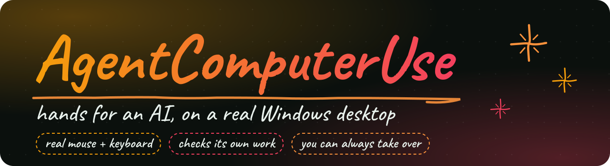
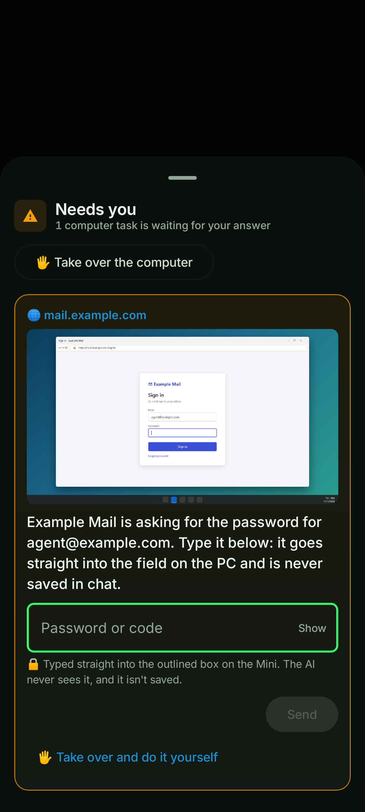
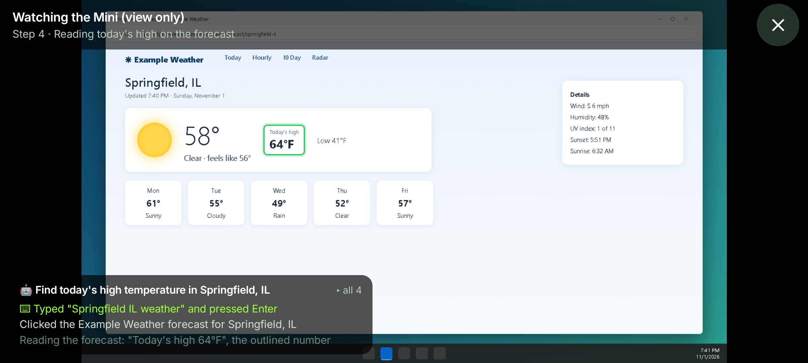
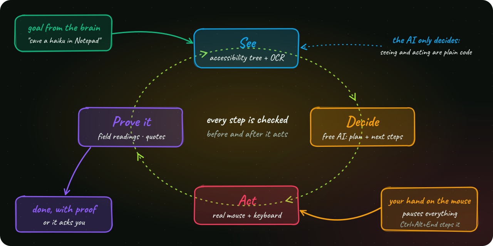

<!-- AgentComputerUse -->

<p align="center"></p>

<p align="center">    </p>

An AI computer-use agent that works a real Windows desktop with the real mouse and keyboard, the way a person does: it opens apps and websites, reads pages, fills in forms and saves files, and it checks its own work before it calls a task done. It's the hands of [AlwaysOnAgent](https://github.com/TheVibeCheckProject/AlwaysOnAgent-Showcase).


&nbsp; **Reads the screen like a screen reader, not a camera.** Windows' accessibility tree and its built-in OCR merge into one numbered list, so the AI only *decides*. Seeing is fast, free and the same every time.

&nbsp; **Proves it's done.** A finished task is double-checked against a trail of real field readings, and an answer must quote on-screen evidence that names what was asked about. A real miss taught it that: a nearby city's temperature once passed as the right one.

&nbsp; **The human always wins.** The owner's real mouse input (told apart from its own by Windows' injected-input flag) pauses it at once. There's a kill switch and a time limit on every run, and nothing acts without `--go`.

&nbsp; **Gets cheaper with use.** A clean run is saved, and the same task asked again replays without the AI ("retasks"). Answers and written text are always produced fresh.


&nbsp; **Tested like an evaluator would.** Development ran on fresh, untuned batches of tasks. Every failure was traced from its run log and fixed in general, never patched to pass one test. The latest batch: 11 of 11 clean, with the monitor off.

&nbsp; **Gated by CI.** Every push runs the full test suite, mypy over all the code, and the ruff linter on a Windows machine. Any failure blocks the change.


| **~10k**<br><sub>lines of Python</sub> | **226**<br><sub>tests</sub> | **11 / 11**<br><sub>clean on a fresh batch</sub> | **28 s**<br><sub>Notepad task, 3 model calls</sub> |
|:---:|:---:|:---:|:---:|


From the owner's phone ([DeskAI](https://github.com/TheVibeCheckProject/Desk-AI-Showcase)): when a task hits something only a person should do, it asks, showing exactly what it sees; and the owner can watch, or take over the computer at any moment, mid-task.

<table><tr><td align="center" valign="top" width="34%"><br><sub><b>Needs you</b>: stuck at a sign-in, it shows the screen and asks for the password. What's typed goes straight into the field on the PC; the AI never sees it and it isn't saved.</sub></td><td align="center" valign="top"><br><sub><b>View only</b>: watch the PC from the phone while it works. The narration names the goal and each step in plain words; the green outline is the exact number it's reading.</sub></td></tr></table>

<sub>Rendered by DeskAI's screenshot tests from a made-up desktop: no real screen or account is shown.</sub>


Every step goes around the same loop. Seeing and acting are plain, deterministic code; the AI is only asked to decide, and its decision is checked before and after it touches anything.

<p align="center"></p>


| Start here | What you'll find |
|---|---|
| [`screen.py`](screen.py), [`ocr.py`](ocr.py) | Seeing: the accessibility tree and Windows OCR merged into one numbered list |
| [`brain.py`](brain.py), [`prompt.py`](prompt.py) | Deciding: the model routes and the rules the model works under |
| [`hands.py`](hands.py) | Acting: human-like mouse paths, and telling the owner's real input apart from its own |
| [`loop.py`](loop.py), [`chain.py`](chain.py) | The loop, and chaining several checked actions from one model reply |
| [`verify.py`](verify.py), [`goals.py`](goals.py) | Proving a task is done: step trails, field readings, what the goal is about |
| [`owner.py`](owner.py), [`takeover.py`](takeover.py) | Keeping the human in charge: pauses, questions to the owner, take over |
| [`retasks.py`](retasks.py), [`replay.py`](replay.py) | Repeating a clean run without the AI, safely |
| [`credentials.py`](credentials.py) | Saved sign-ins in Windows Credential Manager, locked to their own site |


Windows 10 or 11 and Python. Everything is a **dry run unless `--go`** is given, and **Ctrl+Alt+End** stops it.

```powershell
pip install -r requirements.txt
python agentcomputeruse.py windows                     # the open windows, as JSON lines
python agentcomputeruse.py observe --text              # what it sees: the numbered list
python agentcomputeruse.py run "Open Notepad and type a haiku" --go
python -m pytest -q                                    # 226 tests
python -m mypy                                         # types (mypy.ini)
python -m ruff check .                                 # lint (ruff.toml)
```

---

> **About this copy.** This is a sanitized snapshot of a self-hosted, single-user computer-use tool, the "hands" of a personal agent running on a home mini PC. It is not the live private repo: history is not included, and names, places, accounts and paths are placeholders. Licensed MIT.
